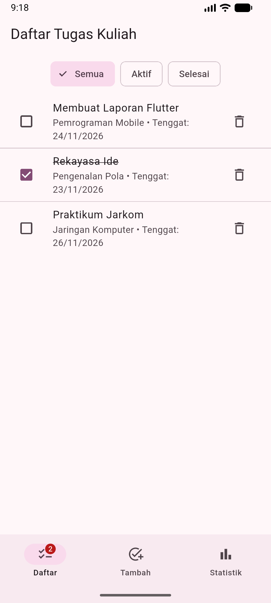
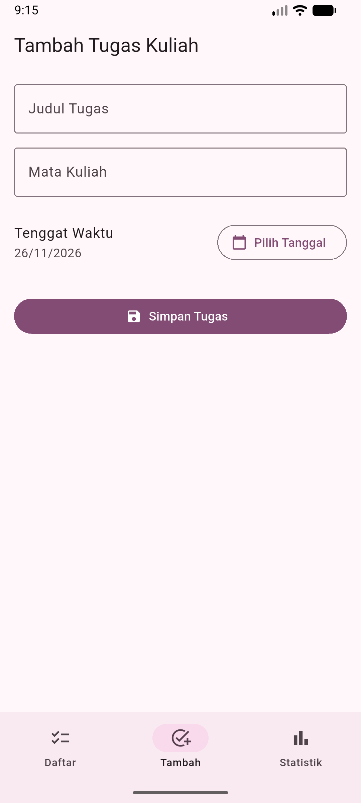
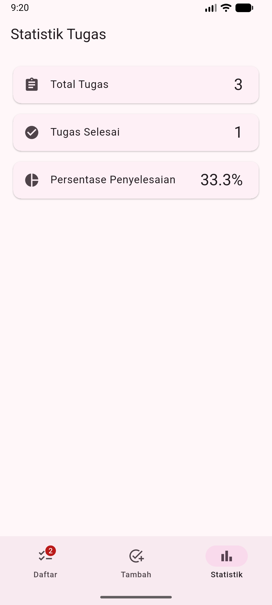

# Tugas Rutin 7 — Planner Tugas Kuliah dengan State Management

## a. Identitas
- **Nama**: Elga Sari Tanjung
- **NIM**: 4243250039
- **Kelas**: PSIK-24C
- **Mata Kuliah**: Pemrograman Mobile

## b. Tangkapan Layar Aplikasi
| Halaman Daftar Tugas | Form Tambah Tugas | Halaman Statistik |
| :---: | :---: | :---: |
|  |  |  |

## c. Diagram Letak State & Alasannya
~~~text
                  [ ChangeNotifierProvider: TugasProvider ]  <-- App State (Bersama)
                   (menyimpan _daftarTugas, statistik, badge)
                     /                 |                  \
                    v                  v                   v
        [ Halaman Daftar ]     [ Halaman Form ]    [ Halaman Statistik ]
         - FilterChip (lokal)   - TextController    - watch<TugasProvider>()
           dikelola setState      initState/dispose   (otomatis rebuild)
~~~

- **App State (`TugasProvider`)**: Diletakkan di atas pohon widget pada `main.dart` agar koleksi daftar tugas, perhitungan statistik, dan jumlah tugas aktif pada badge navigasi dapat dibaca maupun diubah secara sinkron oleh ketiga cabang halaman `go_router` tanpa perlu meneruskan data melalui konstruktor (*prop drilling*).
- **Ephemeral State (`setState`)**: Digunakan untuk menyimpan pilihan filter aktif (`Semua`, `Aktif`, `Selesai`) pada `FilterChip` di Halaman Daftar serta pilihan tanggal tenggat sementara pada Halaman Form karena state tersebut hanya relevan bagi tampilan lokal widget bersangkutan.

## d. Penjelasan Lifecycle & Pemilihan State Management
Pada aplikasi ini, lifecycle `StatefulWidget` diterapkan pada halaman form tambah tugas melalui method `initState()` dan `dispose()`. Method `initState()` dipanggil satu kali saat objek `State` pertama kali dibuat untuk menginisialisasi `TextEditingController` pada input judul tugas dan mata kuliah. Ketika pengguna selesai mengisi form atau berpindah dari halaman tersebut, method `dispose()` dijalankan secara otomatis untuk memanggil `.dispose()` pada kedua controller tersebut. Pembersihan resource ini wajib dilakukan agar alokasi memori controller dilepaskan dengan benar dan tidak menyebabkan kebocoran memori (*memory leak*) maupun pemanggilan setelah widget ditutup.

Untuk pengelolaan *app state*, pendekatan yang dipilih adalah **Provider (`ChangeNotifier`)**. Provider dipilih karena kebutuhan berbagi data pada aplikasi planner tugas berada pada skala menengah—berpusat pada daftar tugas yang diakses oleh halaman daftar, form tambah, statistik, dan badge navigasi. Dibandingkan BLoC yang memerlukan kelas event dan state terpisah sehingga menambah *boilerplate*, `ChangeNotifier` dengan `notifyListeners()` sudah cukup ringkas dan jelas alurnya. Selain itu, penggunaan `context.watch()` pada halaman statistik, `context.read()` pada aksi tombol, dan `context.select()` pada badge navigasi membantu membatasi *rebuild* widget sekaligus memudahkan pengujian logika melalui unit test.

## e. Pernyataan Penggunaan AI
Dalam pengerjaan tugas ini, AI digunakan sebagai asisten diskusi, penyusunan kerangka kode, pengecekan alur pengujian, sedangkan seluruh implementasi, pengujian, dan verifikasi hasil dijalankan secara mandiri pada lingkungan pengembangan masing-masing.
